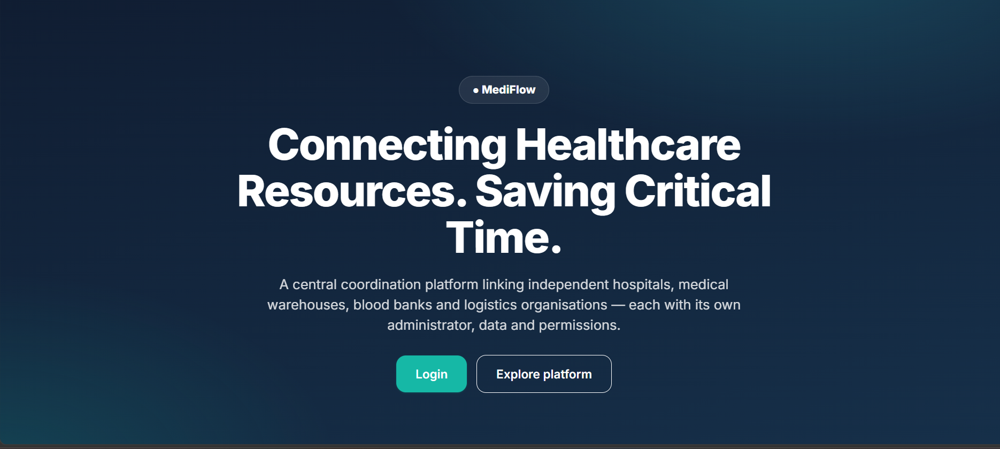

# MediFlow – Medical Resource Coordination Platform

MediFlow is a medical resource coordination platform that demonstrates the use of advanced algorithms for allocating resources and analysing hospital demand.

**Technologies:** Java, Spring Boot, HTML, CSS, JavaScript, Maven, JUnit.

## 1. Prerequisites

- Java JDK 17 or above
- Apache Maven
- Web browser (Chrome/Edge)

## 2. Setup and Run

**Clone the repository:**

```bash
git clone https://github.com/MahekAhuja/MediFlow-CIA3.git
cd MediFlow-CIA3
```

**Run the backend:**

```bash
cd backend
mvn spring-boot:run
```

Backend URL: `http://localhost:8080`

**Run the frontend:**

Open `frontend/index.html` in your browser.

## 3. Environment Configuration

- No external API keys are required for the current local setup.

## 4. API Examples

**Edmonds–Karp – Maximum Flow**

`POST /api/algorithms/max-flow`

```json
{
  "nodes": ["Warehouse", "Hospital"],
  "source": "Warehouse",
  "sink": "Hospital",
  "edges": [
    {
      "from": "Warehouse",
      "to": "Hospital",
      "capacity": 20
    }
  ]
}
```

**Randomized Quickselect – Demand Percentile**

`POST /api/algorithms/demand-percentile`

```json
{
  "demands": [12, 18, 20, 24, 30],
  "percentile": 90,
  "seed": 2026
}
```

## 5. Sample Dataset

Sample input files are available in `backend/sample-data/`:

- `flow-sample.json`
- `max-flow-request.json`
- `demand-sample.json`
- `demand-percentile-request.json`

## 6. Screenshots




## 7. Team Contributions

- **Mahek:** Edmonds–Karp algorithm and Minimum Cut implementation.
- **Ruchita:** Randomized Quickselect and demand percentile analysis.
- **Aayushi:** Frontend development and API integration.

## 8. Testing

Run the backend tests using:

```bash
cd backend
mvn test
```